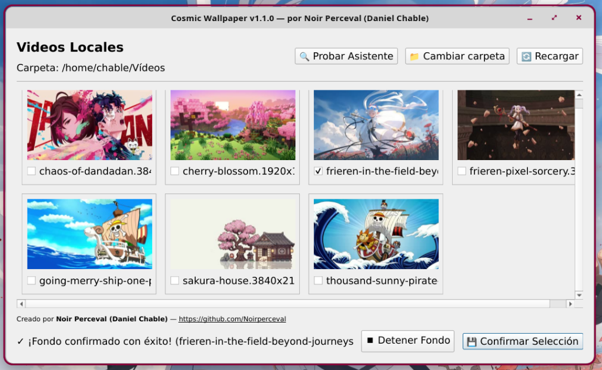

# 🌌 Cosmic Wallpaper

> Fondo animado para **COSMIC Desktop** con rotación de videos, búfer sin cortes y una interfaz monocroma que respeta el escritorio.

<p align="center">
  <a href="https://github.com/Noirperceval/cosmic-wallpaper/releases/latest/download/Cosmic-Wallpaper-x86_64.AppImage">
    
  </a>
  <a href="https://github.com/Noirperceval/cosmic-wallpaper/releases">
    
  </a>
</p>

<p align="center">
  <sub>AppImage autónomo (incluye Python y Qt) · Arch, CachyOS, Fedora, Ubuntu, Debian, Pop!_OS</sub>
</p>

**Versión 2.0.1** · **Creado por:** [Noir Perceval (Daniel Chable)](https://github.com/Noirperceval)
**Repositorio:** [https://github.com/Noirperceval/cosmic-wallpaper](https://github.com/Noirperceval/cosmic-wallpaper)

---

## 📸 Vista previa



*Tema claro disponible en `docs/preview-light.png`.*

---

## ✨ Novedades de la versión 2.0

- **Rediseño monocromo** en blanco y negro, con tema oscuro y claro.
- **Sidebar** con biblioteca, lista de rotación ordenable (arrastra para cambiar el orden) y estado de requisitos.
- **Búfer de doble capa** para que nunca aparezca un fondo negro o estático entre videos.
- **Selección múltiple explícita**: casillas por video, orden de turnos y confirmación persistente.
- **Rotación temporizada**: cambia de video cada 35 s (configurable) o al terminar cada uno, usando IPC de mpv sin reiniciar el reproductor.
- **Vista de cuadrícula o lista**, buscador y filtros por favoritos y recientes.
- **Pausa / reanudación real** y **apagado limpio** (sin dejar procesos huérfanos).
- **Restauración automática** de tu último fondo confirmado al iniciar sesión.
- **Asistente de dependencias** para Arch, CachyOS, Manjaro, Fedora, Ubuntu, Debian, Pop!_OS y openSUSE.

---

## ⚙️ Cómo funciona el búfer (nivel 2)

1. **Caché en RAM de mpv**: `mpvpaper` arranca con `cache=yes`, `cache-secs=300`,
   `demuxer-max-bytes=768MiB`, `demuxer-readahead-secs=60` y `prefetch-playlist=yes`.
   El siguiente video de la rotación ya está precargado antes de que termine el actual.
2. **Frame de respaldo**: antes de lanzar el video, se extrae un frame con `ffmpeg`
   y se pinta como fondo estático con `cosmic-bg`. Si mpv tarda unos milisegundos en
   cambiar de video (o si el reproductor se reinicia), el escritorio muestra ese frame
   en lugar de un fondo negro. Al detener el fondo se restaura tu wallpaper original.

> El frame de respaldo se aplica **antes** de lanzar `mpvpaper` y no se vuelve a tocar
> mientras hay video, para no tapar la capa del reproductor.

---

## 📦 Instalación

### Opción 1: AppImage (recomendada)

1. Descarga `Cosmic-Wallpaper-x86_64.AppImage` desde los
   [releases](https://github.com/Noirperceval/cosmic-wallpaper/releases).
2. Dale permisos de ejecución y ábrelo:

   ```bash
   chmod +x Cosmic-Wallpaper-x86_64.AppImage
   ./Cosmic-Wallpaper-x86_64.AppImage
   ```

Necesitas `mpvpaper` y `ffmpeg` en el sistema (la app te ofrece instalarlos).

### Opción 2: Desde el código fuente

Requisitos: Python 3.10+, `PySide6`, `mpvpaper`, `ffmpeg` y `ffprobe`.

```bash
git clone https://github.com/Noirperceval/cosmic-wallpaper.git
cd cosmic-wallpaper
./install.sh
```

`install.sh` crea el acceso en el menú de aplicaciones, un lanzador para
**detener el fondo** y el inicio automático con la sesión de COSMIC.

Dependencias por distribución:

| Distribución | Comando |
|---|---|
| Arch / CachyOS / Manjaro | `sudo pacman -S mpvpaper ffmpeg python-pyside6` |
| Fedora / Nobara | `sudo dnf install mpvpaper ffmpeg python3-pyside6` |
| Ubuntu / Debian / Pop!_OS | `sudo apt install mpvpaper ffmpeg python3-pyside6` |

Si tu distribución no empaqueta `PySide6`, instálalo con `pip install --user PySide6`.

### Flatpak

El manifiesto `io.github.Noirperceval.CosmicWallpaper.yml` se mantiene como referencia,
pero el runtime KDE no incluye PySide6 y el sandbox no puede lanzar el `mpvpaper` del
sistema. Para Flatpak se recomienda empaquetar el binario generado por PyInstaller o
usar el AppImage.

---

## 🖱️ Uso

- **Cambiar carpeta:** pulsa la ruta en la cabecera.
- **Vista previa en vivo:** haz clic en cualquier tarjeta.
- **Rotación:** marca las casillas de los videos que quieras alternar.
- **Reordenar:** arrastra los elementos de la lista *En rotación*.
- **Añadir el video actual:** botón *Añadir a la rotación*.
- **Favoritos:** clic derecho sobre una tarjeta → *Marcar como favorito*.
- **Fijar:** *Confirmar selección*. Se guardará y se restaurará al iniciar sesión.
- **Pausar:** menú de la bandeja del sistema → *Pausar fondo* (reanuda desde el mismo punto).
- **Detener:** botón *Detener*; se restaura tu wallpaper estático original.

### Rotación

- **Modo por defecto: cada 35 segundos.** Se cambia en **Ajustes → Rotación**
  (también hay presets de 10/15/20/30/35/60 s y un intervalo personalizado).
- **Al terminar cada video**: modo alternativo que respeta la duración natural
  de cada clip, sin cortes.
- Si un video dura **menos** que el intervalo, mpv avanza al terminar (el
  intervalo es un máximo, no un mínimo).
- Con **un solo video** no se aplica el temporizador: se reproduce en bucle.
- El cambio se hace por **IPC de mpv** (`playlist-next`), sin reiniciar
  `mpvpaper`: no hay recarga ni pérdida del búfer.
- El pie muestra `cambia en mm:ss` con una barra de progreso, y la bandeja del
  sistema tiene **Siguiente video** para forzar el cambio al instante.

### Línea de comandos

```bash
cosmic_wallpaper_gui.py --stop        # detiene el fondo y restaura el wallpaper
cosmic_wallpaper_gui.py --no-restore  # abre sin restaurar el último fondo
cosmic_wallpaper_gui.py --test-deps   # abre el asistente de requisitos
```

### Archivos de configuración

- Preferencias y rotación: `~/.config/cosmic-wallpaper/config.json`
- Miniaturas y frames de respaldo: `~/.cache/cosmic-wallpaper/`
- Wallpaper original (se restaura al salir): `~/.cache/cosmic-wallpaper/cosmic-bg-original.conf`

---

## 💻 Construir el AppImage

```bash
./build-appimage.sh
```

Genera `Cosmic-Wallpaper-x86_64.AppImage` con PyInstaller + appimagetool.

---

## 📄 Licencia y créditos

Desarrollado para la comunidad de COSMIC Desktop por
**Noir Perceval (Daniel Chable)** · [GitHub](https://github.com/Noirperceval)
